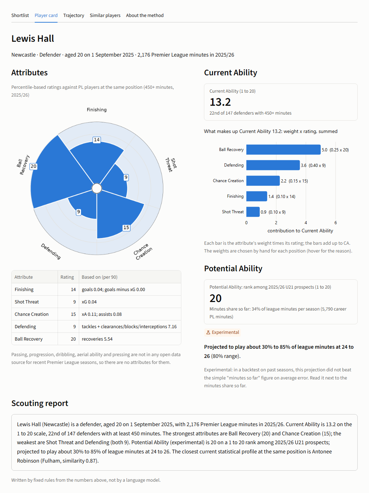
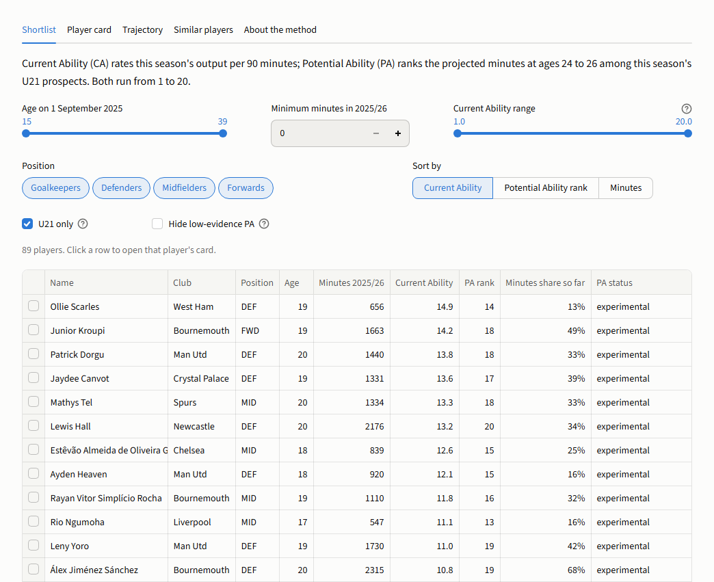
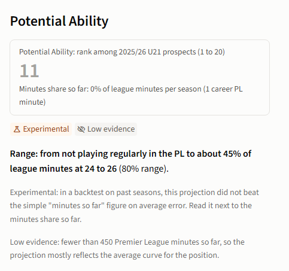
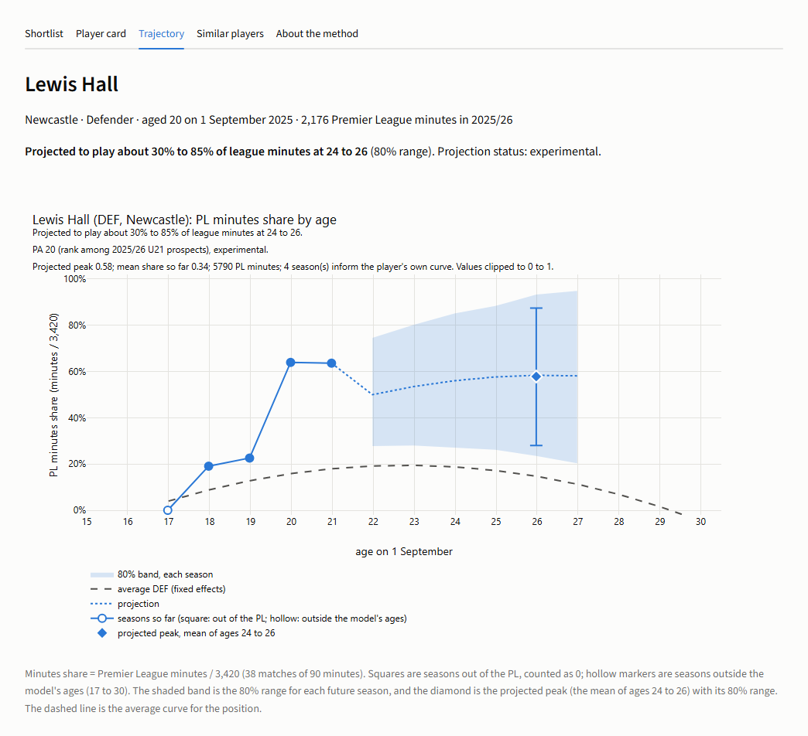
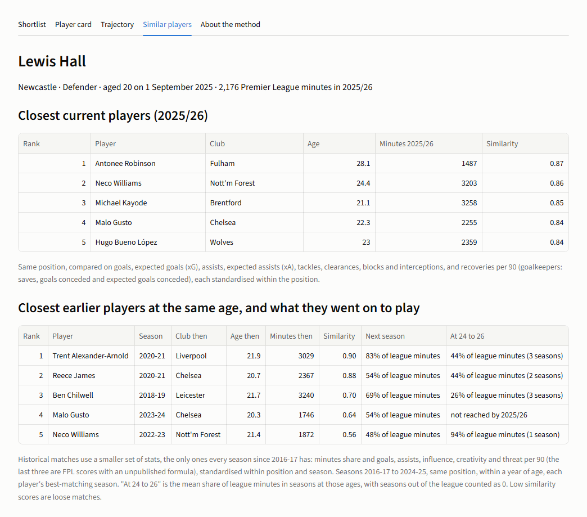

# Premier League U21 Prospects

A Football Manager-style scouting tool for Premier League players aged under 21, built on open data. It rates what each young player did in 2025/26, projects how much Premier League football they might play in their mid-twenties, and tests that projection honestly against what happened to earlier cohorts.

This is a non-commercial portfolio project. All data stays local, and the app runs on your own machine only (see [How to run it](#8-how-to-run-it)).

**Demo video:** <!-- TODO: demo video link -->



**At a glance**
- **Who:** the 89 players who were under 21 on 1 September 2025 and played Premier League minutes in 2025/26.
- **Now:** 1 to 20 attributes and a Current Ability score for every player with at least 450 minutes, rated against the whole league at the same position.
- **Later:** a mixed-effects age curve of Premier League minutes projects each U21's share of minutes at ages 24 to 26, with an 80% range, shown as a rank among this season's prospects.
- **Tested:** a time-split backtest on four earlier seasons. The model does not beat the simple "minutes so far" figure on average error, so the projection is labelled experimental and shown next to it.
- **Built with:** Python 3.14, pandas, NumPy, statsmodels, Streamlit, Plotly, mplsoccer and pytest, on open Fantasy Premier League and Transfermarkt data.

**Contents:** [The question](#1-the-question) · [What the tool shows](#2-what-the-tool-shows) · [How it works](#3-how-it-works-in-plain-english) · [The backtest](#4-does-it-work-the-backtest) · [Insights](#5-three-insights) · [Limitations](#6-limitations) · [Data and terms](#7-data-sources-and-terms) · [How to run it](#8-how-to-run-it) · [Structure](#9-repository-structure) · [Next steps](#10-next-steps)

## 1. The question

Which young players with Premier League minutes look strongest now, and how might they develop? The tool answers the first part with per-90 ratings against the whole league, and the second with a statistical age curve of Premier League minutes. Both come with plain statements of what the data cannot tell you.

## 2. What the tool shows

A Streamlit app with five pages. It covers the 89 players who were under 21 on 1 September 2025 and played Premier League minutes in 2025/26, and can also show any other player with minutes that season.

| Page | What it shows |
| --- | --- |
| **Shortlist** | A table you can filter by age, position, minutes, Current Ability and "hide low-evidence projections", sorted by Current Ability (or by the Potential Ability rank, with a note that it is experimental). Click a row to open the card. |
| **Player card** | 1 to 20 attributes as a pizza chart and a table, Current Ability with each attribute's contribution, Potential Ability with its range in words, and a short scouting report. |
| **Trajectory** | The player's Premier League minutes share by age so far, the projection to age 26 with an 80% band, and the average curve for the position. |
| **Similar players** | The five most similar current players, and the five most similar earlier players at the same age, with what those players went on to play at 24 to 26. |
| **About the method** | This page's method and backtest in brief, with the numbers read from the backtest file. |

The screenshots below come from the app running locally on the 2025/26 data.

### Shortlist



Filter by age, position, minutes, Current Ability, "U21 only" and "hide low-evidence PA", and sort by Current Ability, the Potential Ability rank or minutes. "Minutes share so far" sits next to the PA rank, so a coach can compare the projection with what has actually happened.

### Player card

The screenshot at the top of this page is Lewis Hall's card. It has four parts:

- **Attributes (1 to 20):** Finishing, Shot Threat, Chance Creation, Defending and Ball Recovery for outfield players, and Goalkeeping for goalkeepers, the only ones the open data supports for 2025/26. They are drawn as a pizza chart, with a table of the per-90 numbers behind each rating.
- **Current Ability (CA):** a weighted average of the attributes, with a bar showing what each attribute contributes (weight x rating).
- **Potential Ability (PA):** a rank from 1 to 20 among this season's U21 prospects, based on projected minutes at ages 24 to 26. It comes with an 80% range in words, the player's minutes share so far, and an "experimental" tag.
- **Scouting report:** three to five plain sentences written by fixed rules from the numbers on the card, not by a language model. For Lewis Hall:

  > Lewis Hall (Newcastle) is a defender, aged 20 on 1 September 2025, with 2,176 Premier League minutes in 2025/26. Current Ability is 13.2 on the 1 to 20 scale, 22nd of 147 defenders with at least 450 minutes. The strongest attributes are Ball Recovery (20) and Chance Creation (15); the weakest are Shot Threat and Defending (both 9). Potential Ability (experimental) is 20 on a 1 to 20 rank among 2025/26 U21 prospects; projected to play about 30% to 85% of league minutes at 24 to 26. The closest current statistical profile at the same position is Antonee Robinson (Fulham, similarity 0.87).

When a projection rests on fewer than 450 career minutes, the rank is greyed out and tagged "Low evidence". Nehemiah Oriola, with 1 career minute, is an example:



### Trajectory



The player's Premier League minutes share by age so far (solid line) is shown alongside the projection to age 26 with an 80% band for each season (shaded). The diamond marks the projected peak, the mean of ages 24 to 26, with its range, and the dashed line is the average curve for the position.

### Similar players



The top table holds the five most similar current players at the same position. The bottom one holds the five most similar earlier players at the same age, with what they went on to play the next season and at 24 to 26. Historical matches use a smaller set of stats, because only those exist for every season since 2016-17.

## 3. How it works, in plain English

**From numbers to 1 to 20 ratings.** For every player with at least 450 Premier League minutes in 2025/26, each season total becomes a per-90 figure (goals, expected goals, assists, tackles plus clearances, blocks and interceptions, and so on). Each per-90 figure is compared with every Premier League player in the same position with 450+ minutes, not only under-21s, so a rating is absolute, as in Football Manager. The percentile becomes a rating with `1 + floor(percentile x 20)`, capped at 20: a 15 means better than about 70% of the league at that position. An attribute with two inputs averages their percentiles. The comparison groups are 28 goalkeepers, 147 defenders, 181 midfielders and 44 forwards.

**Current Ability.** A weighted average of the attributes, with weights chosen by hand for each position and a reason for each one. For example, a defender's CA is 40% Defending, 25% Ball Recovery, 15% Chance Creation and 10% each for Shot Threat and Finishing. The card shows each attribute's contribution, so nothing is hidden. CA measures output per 90 minutes, not how much a player played.

| Position | Weights |
| --- | --- |
| Goalkeeper | Goalkeeping 1.00 |
| Defender | Defending .40, Ball Recovery .25, Chance Creation .15, Shot Threat .10, Finishing .10 |
| Midfielder | Chance Creation .30, Ball Recovery .25, Defending .15, Shot Threat .15, Finishing .15 |
| Forward | Shot Threat .35, Finishing .30, Chance Creation .20, Ball Recovery .10, Defending .05 |

**The age curve.** The outcome is **minutes share**: a player's Premier League minutes in a season divided by 3,420 (38 matches of 90 minutes). A season out of the league counts as 0. A mixed-effects model (statsmodels MixedLM) fits an average curve of minutes share against age and age squared, shifted by position, plus a personal adjustment for each player: their own level and their own rate of change. With one or two seasons of history, a player's own record is trusted only partly and the rest comes from the average. One bright half-season does not make a projection.

**Why the model only learns from players first seen young.** The data starts in 2016-17. A player who was already 25 then is only in the data because they were still in the league at 25; everyone their age who had dropped out is invisible. A model that learns from those survivors expects far too much of young players. So the model is fitted only on players whose first Premier League season with minutes came at 20 or under: 2,680 seasons from 515 players (`trajectory_model_summary.txt`). For them the data sees the whole story, including dropping out.

**Potential Ability as a rank.** For each U21, the model simulates 2,000 possible futures and takes the middle value of their average minutes share at ages 24 to 26. PA ranks that value against the 84 other projected U21s this season, all positions together, on the same 1 to 20 scale. It is a comparison between this season's prospects, not a rating against the whole league.

**Uncertainty.** Every projection has an 80% range (the 10th to 90th percentile of the simulated futures), written in words, for example "Range: from not playing regularly in the PL to about 45% of league minutes at 24 to 26". Most ranges start at zero. That is partly the real chance of dropping out of the league and partly a side effect of how the model works (see [Limitations](#6-limitations)). A PA based on fewer than 450 career Premier League minutes is greyed out as low evidence (49 of 85 players). Players whose seasons so far all came before age 17 get no PA (4 players).

## 4. Does it work? The backtest

**The verdict: the model does not beat the simple "minutes so far" baseline on average error. Fitting it only on players first seen young cut its over-prediction by more than half, but that was not enough.**

The test went back to four earlier seasons (2017-18 to 2020-21), refitted the model using only what was known at the time, and predicted how much each season's under-21s would play at ages 23 to 25. That made 242 forecasts, compared with what actually happened and with two simple baselines:
- **minutes so far (persistence):** the player's average minutes share up to that season;
- **average curve only:** the position's average curve, ignoring the player's own record.

Only 2020-21 had enough seasons at ages 23 to 25 in the training data to check the peak (78 seasons; the threshold set in advance was 50). The earlier origins extrapolate the curve. Results from `data/processed/backtest_results.csv` (errors are in shares of league minutes, so 0.10 is 10 percentage points):

| Test set | Method | Forecasts | Average error (MAE) | Ranking (Spearman) | Bias |
| --- | --- | --- | --- | --- | --- |
| 2020-21 (peak checked) | Model, fitted on players first seen young | 64 | 0.232 | 0.419 | +0.096 |
| 2020-21 (peak checked) | Minutes so far | 64 | **0.193** | 0.375 | -0.033 |
| 2020-21 (peak checked) | Average curve only | 64 | 0.241 | 0.027 | +0.026 |
| All four origins | Model, fitted on players first seen young | 242 | 0.244 | 0.287 | +0.070 |
| All four origins | First model, fitted on all players | 242 | 0.280 | 0.297 | +0.159 |
| All four origins | Minutes so far | 242 | **0.214** | 0.314 | -0.071 |
| All four origins | Average curve only | 242 | 0.256 | -0.016 | +0.032 |

What this means:
- **Minutes so far wins on average error** at the checked origin (0.193 against 0.232) and over all four (0.214 against 0.244).
- **The fix helped.** Restricting the model to players first seen young cut the average over-prediction from +0.159 to +0.070 and lowered the error at every origin.
- **Ranking is close.** At 2020-21 the model ranked players slightly better than minutes so far (Spearman 0.419 against 0.375), but that is one season and 64 players.
- **Ranges are roughly right where the peak is checked.** The 80% range held the real outcome 81.2% of the time at 2020-21, but 65.7% over all four origins. A widening factor of 1.43 was estimated from those errors (`interval_calibration.json`). The cards use the unwidened range, a choice made after seeing these results and kept in the data as a check.

**Why it matters.** A projection that cannot beat "how much has the player played so far" should not drive decisions on its own. That is why the card shows PA as experimental, right next to the minutes share so far.

**What would improve it:**
- extending the history back to 2012/13 with Transfermarkt Premier League appearances, so the peak can be tested at more origins and the misclassified early debutants come back;
- adding minutes so far (or last season's share) as a predictor, or a two-part model: first the chance of playing in the league at all, then the share given that they do;
- more seasons, which arrive one a year.

## 5. Three insights

1. **Survivors make the late twenties look better than they are.** At ages 24 to 26, players first seen at 20 or under averaged a minutes share of **0.164**, against **0.312** for players first seen older (`backtest_summary.md`, diagnostic table, 2,320 player-seasons). The older group is in the data only because they were still in the league when it starts in 2016-17. A model that learns from everyone therefore expects far too much of today's young players, which is why this one learns only from players first seen young.
2. **Averaged over everyone who broke through young, minutes peak early and low.** This is an average, not a typical career. The curve averages the minutes share of every player first seen at 20 or under, including those who later left the league and count as 0 from then on. That average peaks at age **22.8**, where a defender plays about **19%** of league minutes (0.194 at 23). Individual players sit above or below it. The same model fitted on all players, survivors included, puts the average peak at **24.5**, with a defender at **0.351** of league minutes at 24 (`trajectory_model_summary.txt`).
3. **Most young players have too few minutes to rate yet.** Only **31 of the 89** U21s with 2025/26 Premier League minutes reached 450 minutes, the threshold for per-90 ratings. The 89 is the row count of `u21_cohort_2025_26.csv`, and the 31 are its rows with `minutes` of 450 or more; the same 31 have `enough_minutes` in `u21_cards_2025_26.parquet`. For those 31 players (13 defenders, 15 midfielders, 3 forwards), the Spearman rank correlation between Current Ability and the Potential Ability rank is **0.20**, with an approximate 95% interval from **-0.18 to 0.52** (`ca_pa_correlation_2025_26.json`; 0.19 using the projected minutes share instead of the rank). The interval includes both no relationship and a moderate one, so **we can't yet say whether current quality predicts future minutes**. Two notes:
   - PA is a projection of minutes, not minutes actually played, so a real test needs these players' future seasons.
   - The PA model uses only minutes so far, age and position, never per-90 output, so the two scores come from separate data.

   Until then, the card shows CA and PA side by side and never combines them.

## 6. Limitations

**Data coverage**
- Only players who have already played Premier League minutes are covered. There is no academy or youth-league data (survivorship).
- There is no Championship or other EFL data, and no player minutes for 17 other leagues in the Transfermarkt dataset, so a loan there looks like time out of the league.
- The attribute set is limited. Open sources have no passing, progression, dribbling, aerial or pressing data for recent Premier League seasons, so there are no ratings for them.
- Defensive stats exist only from 2025/26, so the trajectories model minutes, not output.
- Per-90 numbers are noisy for players with few minutes, and FPL has only four positions (a holding midfielder is compared with attacking midfielders).
- Minutes and output depend on club, manager, role and competition for places, not just ability.

**The model**
- **Left truncation.** The data starts in 2016-17, so the model is fitted only on players first seen at 20 or under. At least 75 players who did debut young before 2016-17 are wrongly counted as "first seen older" and left out (`truncation_check.csv`; a lower bound, because Transfermarkt misses some seasons).
- **The peak was tested at one origin only** (2020-21, 64 forecasts, with no training season at age 25).
- **A Gaussian model on a zero-heavy outcome.** Half the seasons the model learns from are zeros, and minutes share cannot go below 0 or above 1. The model ignores both facts, so it can predict impossible values. They are clipped to 0% to 100% for display (3 raw middle values were below 0).
- **Most ranges start at zero, partly because of the model.** For **76 of 85** projected U21s the 80% range starts at 0%; the most common card reads "from not playing regularly in the PL to about 45% of league minutes at 24 to 26" (22 players) (`pa_projections_2025_26.parquet`). Dropping out of the league is a real outcome, but this count is partly an artefact of the Gaussian model. Its simulated futures spread evenly either side of the middle, so for most prospects the lower end falls below zero and is cut to 0% (74 of 85 raw lower bounds). A two-part model, with the chance of playing in the league at all and then the share given that, would put a direct number on dropping out instead.
- **Wide ranges.** The median 80% range spans 0.66 of league minutes before clipping. The ranges from the 2025/26 fit were not tested directly; the backtest suggests they are about right where the peak is identified and too narrow elsewhere.
- **The model does not beat "minutes so far"** on average error in the backtest, so PA is experimental.

**How PA is shown**
- **PA is relative to this season's prospects**, all positions together. The model expects fewer minutes for young forwards, so forwards rank lower on average (mean PA 8.0 for forwards, 13.0 for defenders).
- **Low evidence:** 49 of 85 projections rest on fewer than 450 career minutes and mostly reflect the average curve. They are greyed out.
- **No PA for under-17 debutants** (4 players), because the model is not fitted below 17.
- **CA and PA measure different things:** CA is this season's output per 90 minutes; PA is projected minutes. A player can be high on one and low on the other (rank correlation 0.20 among the 31 U21s with both, `ca_pa_correlation_2025_26.json`).
- "Potential" here is a statistical projection with wide uncertainty, not a verdict on a player.

## 7. Data sources and terms

No data is included in this repository. The pipeline downloads it into `data/`, which is gitignored apart from `data/manual_matches.csv`, a small file of hand-made matching fixes. Raw data is never redistributed.

| Source | Used for | Terms |
| --- | --- | --- |
| **Fantasy Premier League**, via the [vaastav/Fantasy-Premier-League](https://github.com/vaastav/Fantasy-Premier-League) archive | Minutes, goals, expected goals and assists, defensive actions, positions and birth dates, 2016-17 to 2025-26 | The archive's code is MIT licensed; the data belongs to the Premier League, whose terms allow private, non-commercial use and prohibit commercial use. |
| **Transfermarkt**, via [dcaribou/transfermarkt-datasets](https://github.com/dcaribou/transfermarkt-datasets) (Kaggle: `davidcariboo/player-scores`) | Birth dates for seasons before 2024-25, matching players across seasons, and checks on minutes and truncation | The repository is CC0, but the data was collected from Transfermarkt, so it is used for non-commercial purposes only. Credit to Transfermarkt and the dataset's author. |

The screenshots in this README show derived figures for a handful of players, to illustrate the analysis. The tables behind them are not published.

StatsBomb Open Data is not used yet. It is planned for a separate event-data module (see [Next steps](#10-next-steps)) under the StatsBomb Public Data User Agreement. Please check each source's terms yourself before reusing anything from this project.

## 8. How to run it

Developed with Python 3.14 on Windows. Run everything from the repository root.

```powershell
# 1. Set up the environment
python -m venv .venv
.venv\Scripts\Activate.ps1          # macOS or Linux: source .venv/bin/activate
pip install -r requirements.txt     # or, for the exact tested environment: pip install -r requirements-lock.txt

# 2. Download the data and build everything (about 108 MB of downloads, about 2 minutes of processing)
python run_pipeline.py

# 3. Open the app
streamlit run app/streamlit_app.py

# 4. Run the tests
python -m pytest
```

- `python run_pipeline.py` runs eleven stages in order: load, audit, matching, cohort, features, panel, trajectory, validate, ability, similarity, figures. It prints one line per stage with its time and writes each stage's own output to `data/processed/pipeline_log.txt`.
  - `--skip-download` uses the raw files already in `data/raw/`.
  - `--from STAGE` resumes from a stage, for example `--from trajectory`.
  - `--verbose` shows each stage's output on screen.
- If the Transfermarkt download fails, the load stage prints instructions for getting the same tables from Kaggle by hand.
- Each stage can also be run on its own, for example `python -m src.audit` or `python -m src.features --show Diouf Kroupi`. `python -m src.report_text Hall Oriola` prints scouting reports.
- The app reads only `data/processed/`. If the files are not there, it says to run the pipeline. A player's page can be bookmarked: the address names the page and the player's FPL code, for example `?page=Player+card&player=487838`.

**Two requirements files.**
- `requirements.txt` lists the direct dependencies, each pinned.
- `requirements-lock.txt` is the output of `pip freeze` from the tested environment (Python 3.14.6 on Windows). It pins every installed package, including the ones the direct dependencies pull in, so use it to reproduce the environment exactly.

**Running locally only.** The app is meant to run on your own machine and is not hosted anywhere. Hosting it, for example on Streamlit Community Cloud, would mean publishing the processed tables it reads. That would redistribute data derived from FPL and Transfermarkt, which this project's use of both sources rules out. The demo video at the top of this page shows the app instead.

## 9. Repository structure

```
├── README.md
├── requirements.txt           direct dependencies, pinned
├── requirements-lock.txt      every installed package (pip freeze)
├── pytest.ini
├── run_pipeline.py            one command for every stage, in order
├── .streamlit/config.toml     app theme (light, to match the charts)
├── app/
│   └── streamlit_app.py       the app (layout only)
├── src/
│   ├── config.py              paths, seasons, thresholds and URLs
│   ├── load_data.py           downloads the raw files and reads them back
│   ├── audit.py               data-quality checks and report
│   ├── clean.py               shared cleaning steps
│   ├── matching.py            FPL to Transfermarkt player matching
│   ├── cohort.py              the U21 cohort of any season
│   ├── features.py            per-90 stats, percentiles and 1 to 20 attributes
│   ├── panel.py               one row per player per PL season, 2016-17 to 2025-26
│   ├── trajectory.py          the mixed-effects age curve and projections
│   ├── calibration.py         widening factors for projection ranges, from the backtest
│   ├── validate.py            the backtest
│   ├── ability.py             Current Ability and Potential Ability
│   ├── similarity.py          current and historical similar players
│   ├── figures.py             trajectory charts
│   ├── report_text.py         rule-based scouting reports
│   ├── app_data.py            data loading and tables for the app
│   └── app_charts.py          the pizza and Current Ability charts
├── docs/
│   ├── trajectory_model.md    the age-curve model explained in plain English
│   └── images/                screenshots used in this README
├── data/                      gitignored, apart from manual_matches.csv
│   ├── raw/                   downloaded files
│   ├── processed/             pipeline outputs
│   └── manual_matches.csv     hand-made fixes for player matching
├── notebooks/                 exploration only
└── tests/                     pytest suite
```

## 10. Next steps

- **Transfermarkt back to 2012/13** for Premier League minutes, so "first seen" ages are right for early debutants and the peak can be tested at more origins.
- **Minutes so far as a predictor, or a two-part model** (in the league or not, then minutes share), judged with the same backtest.
- **A backtested "chance of becoming a regular"**, for example the probability of playing half the league's minutes at 24 to 26, which may be more useful to a coach than a share.
- **A StatsBomb event-data module**: event-based attributes and radars on the 2015/16 Premier League and Euro 2024, kept separate from the cards because the stat definitions differ.
- **A short demo video** of the app, linked at the top of this page, since the app is not hosted.
